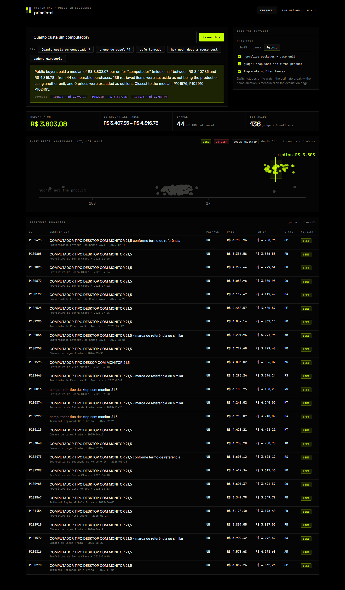
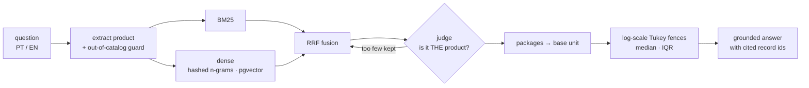
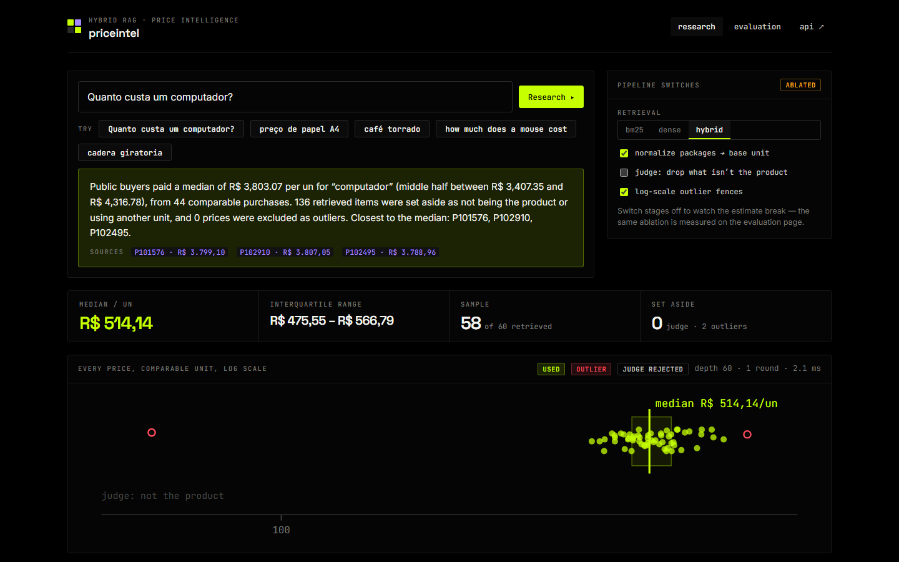
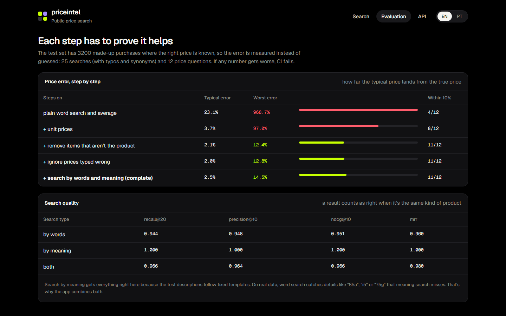

<div align="center">

# priceintel · hybrid-rag-price-intel

**"How much did the public sector actually pay for this?" — answered with hybrid retrieval,
an LLM-as-judge, unit normalization and robust statistics, and *measured* against ground truth.**


**English** · [Português](README.pt-BR.md)



</div>

---

## Why this is harder than "RAG over a table"

Ask for *computador* and lexical search ranks **"Mesa para computador"** first.
Paper is sold per ream *and* per box of 10 reams. Coffee comes in 250 g, 500 g
and 1 kg. Buyers type a box price into the unit field. Average that naively and
the answer is off by **970%**. This repository is the pipeline that gets it
within a few percent — and the evaluation that proves each stage pulls its weight.



## Measured (docs/EVAL.md, regenerated in CI)

| pipeline | median error | worst error | within 10% |
|---|---|---|---|
| raw: BM25, package prices, no judge, no outlier filter | 23.1% | **968.7%** | 4/12 |
| + unit normalization | 3.7% | 97.0% | 8/12 |
| + judge | 2.1% | 12.4% | 11/12 |
| + outlier filter | 2.0% | 12.8% | 11/12 |
| + hybrid retrieval (full pipeline) | 2.5% | 14.5% | 11/12 |

Retrieval nDCG@10: BM25 0.951 · dense 1.000 · hybrid 0.966. Dense is perfect *because the
synthetic descriptions come from templates* — stated, not hidden ([ADR 0001](docs/adr/0001-hybrid-retrieval-with-rrf.md)).
CI fails if nDCG@10 < 0.9 or the price error regresses ([ADR 0003](docs/adr/0003-synthetic-ground-truth.md)).

## What it demonstrates

- **Hybrid retrieval**: BM25 implemented from scratch (PT light stemming, synonym expansion),
  offline char-n-gram embeddings, **pgvector** HNSW index (integration-tested against the
  in-memory one), **Reciprocal Rank Fusion**.
- **LLM-as-judge with graceful degradation**: batch JSON contract, per-batch fallback to an
  explainable rule judge; every rejection carries a reason shown in the UI.
- **Agentic retrieval depth**: when the judge rejects most results, search goes deeper and re-judges.
- **Domain normalization**: packaging labels → base units (`CX C/ 10`, `PCT 500G`, `CX C/ 10 RESMAS`).
- **Robust statistics**: Tukey fences on log prices (×10 and ÷10 typos are symmetric), median + IQR,
  trimmed mean, low-confidence flag for small samples.
- **Grounded generation**: every number in the answer comes from the computation and cites record ids;
  clicking a source jumps to that purchase in the table. An out-of-catalog guard refuses to invent a price for "oi" or "foguete".
- **Evaluation as a first-class artifact**: synthetic data with hidden truth, IR metrics, ablations, CI gate.
- **Next.js 15 (App Router, TypeScript)** frontend: live pipeline switches to *watch the estimate
  break*, SVG strip plot on a log scale, server-rendered evaluation page. The UI switches between EN and PT-BR.

| Judge switched off: the median becomes the price of a table | Evaluation page |
|---|---|
|  |  |

## Quick start

```bash
git clone https://github.com/murilo-bassan/hybrid-rag-price-intel.git && cd hybrid-rag-price-intel
pip install -r requirements-dev.txt
docker compose up -d pgvector            # optional: enables the pgvector integration test
python -m pytest                         # 36 tests incl. the quality gate
python -m uvicorn priceintel.api:app --port 8900

cd web && npm ci && npm run build && npm start   # → http://localhost:3000
```

The default judge is rule-based and explains every rejection. For an LLM judge: `PI_JUDGE=llm PI_JUDGE_MODEL=... LLM_API_KEY=...`
from your environment — no key is, or should be, in the repository. Full stack: `docker compose up --build`.

All data is synthetic; agencies, cities and suppliers are fictional.

## Decisions
- [0001 — Hybrid retrieval fused with RRF](docs/adr/0001-hybrid-retrieval-with-rrf.md)
- [0002 — A judge between retrieval and statistics, with adaptive depth](docs/adr/0002-judge-before-statistics.md)
- [0003 — Synthetic data with a hidden ground truth, and a CI quality gate](docs/adr/0003-synthetic-ground-truth.md)

---

<sub>Part of an AI engineering portfolio — see [ai-engineering-portfolio](https://github.com/murilo-bassan/ai-engineering-portfolio). MIT licensed.</sub>
