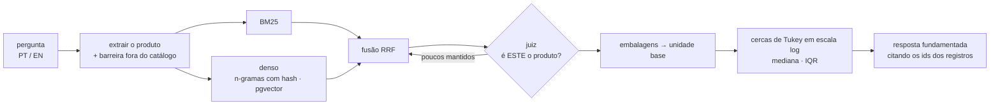

<div align="center">

# priceintel · hybrid-rag-price-intel

**"Quanto o setor público pagou de verdade por isto?", respondido com busca híbrida,
um LLM como juiz, normalização de unidades e estatística robusta, e *medido* contra um gabarito.**


[English](README.md) · **Português**


</div>

---

## Por que é mais difícil que "RAG sobre uma tabela"

Busque *computador* e a busca lexical traz primeiro **"Mesa para computador"**.
Papel é vendido por resma *e* por caixa com 10 resmas. Café vem em 250 g, 500 g
e 1 kg. Comprador digita o preço da caixa no campo do unitário. Tire a média sem
cuidado e a resposta erra em **970%**. Este repositório é o pipeline que chega a
poucos pontos percentuais de erro, e a avaliação que prova que cada etapa vale o
que custa.



## Medido (docs/EVAL.md, regenerado no CI)

| pipeline | erro mediano | pior erro | dentro de 10% |
|---|---|---|---|
| bruto: BM25, preço da embalagem, sem juiz, sem filtro de outlier | 23,1% | **968,7%** | 4/12 |
| + normalização de unidade | 3,7% | 97,0% | 8/12 |
| + juiz | 2,1% | 12,4% | 11/12 |
| + filtro de outliers | 2,0% | 12,8% | 11/12 |
| + busca híbrida (pipeline completo) | 2,5% | 14,5% | 11/12 |

nDCG@10 da busca: BM25 0,951 · denso 1,000 · híbrido 0,966. O denso é perfeito *porque as
descrições sintéticas vêm de templates*, e isso está dito, não escondido ([ADR 0001](docs/adr/0001-hybrid-retrieval-with-rrf.md)).
O CI falha se o nDCG@10 ficar abaixo de 0,9 ou se o erro de preço piorar ([ADR 0003](docs/adr/0003-synthetic-ground-truth.md)).

## O que demonstra

- **Busca híbrida**: BM25 implementado do zero (stemming leve em PT, expansão de sinônimos),
  embeddings offline de n-gramas de caracteres, índice HNSW no **pgvector** (com teste de
  integração contra o índice em memória) e **Reciprocal Rank Fusion**.
- **LLM como juiz, com degradação segura**: contrato JSON em lote e, por lote, queda para um
  juiz de regras explicável; toda exclusão traz um motivo que aparece na interface.
- **Profundidade de busca agêntica**: quando o juiz rejeita a maior parte, a busca vai mais fundo e julga de novo.
- **Normalização do domínio**: rótulos de embalagem → unidade base (`CX C/ 10`, `PCT 500G`, `CX C/ 10 RESMAS`).
- **Estatística robusta**: cercas de Tukey sobre o log do preço (erros de ×10 e ÷10 ficam simétricos),
  mediana + IQR, média aparada e aviso de baixa confiança para amostras pequenas.
- **Geração fundamentada**: todo número da resposta vem do cálculo e cita os ids dos registros;
  clicar numa fonte leva à compra na tabela. Uma barreira de fora do catálogo se recusa a inventar
  preço para "oi" ou "foguete".
- **Avaliação como artefato de primeira classe**: dados sintéticos com gabarito oculto, métricas de IR, ablações, portão no CI.
- **Front-end em Next.js 15 (App Router, TypeScript)**: chaves do pipeline ao vivo para *ver a
  estimativa quebrar*, gráfico de dispersão em SVG em escala log, página de avaliação renderizada no servidor.
  Interface com opção PT-BR/EN.

| Juiz desligado: a mediana vira o preço de uma mesa | Página de avaliação |
|---|---|
|  |  |

## Como rodar

```bash
git clone https://github.com/murilo-bassan/hybrid-rag-price-intel.git && cd hybrid-rag-price-intel
pip install -r requirements-dev.txt
docker compose up -d pgvector            # opcional: habilita o teste de integração com pgvector
python -m pytest                         # 36 testes, incluindo o portão de qualidade
python -m uvicorn priceintel.api:app --port 8900

cd web && npm ci && npm run build && npm start   # → http://localhost:3000
```

O juiz padrão é de regras e explica cada exclusão. Para um juiz com LLM: `PI_JUDGE=llm PI_JUDGE_MODEL=... LLM_API_KEY=...`
vindos do seu ambiente; nenhuma chave está, nem deve estar, no repositório. Stack completa: `docker compose up --build`.

## Decisões (em inglês)
- [0001 — Busca híbrida com fusão RRF](docs/adr/0001-hybrid-retrieval-with-rrf.md)
- [0002 — Um juiz entre a busca e a estatística, com profundidade adaptativa](docs/adr/0002-judge-before-statistics.md)
- [0003 — Dados sintéticos com gabarito oculto e portão de qualidade no CI](docs/adr/0003-synthetic-ground-truth.md)

Todos os dados são sintéticos; órgãos, cidades e fornecedores são fictícios.

---

<sub>Parte de um portfólio de engenharia de IA: veja [ai-engineering-portfolio](https://github.com/murilo-bassan/ai-engineering-portfolio). Licença MIT.</sub>
